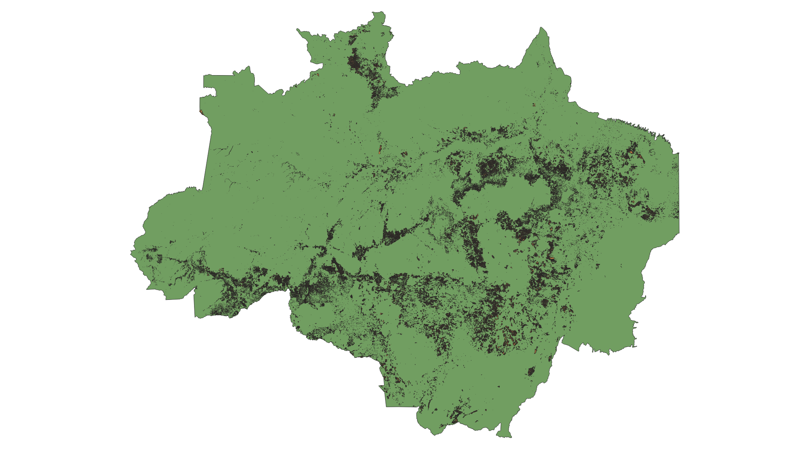
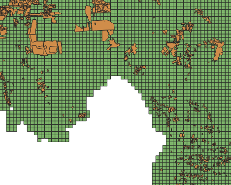
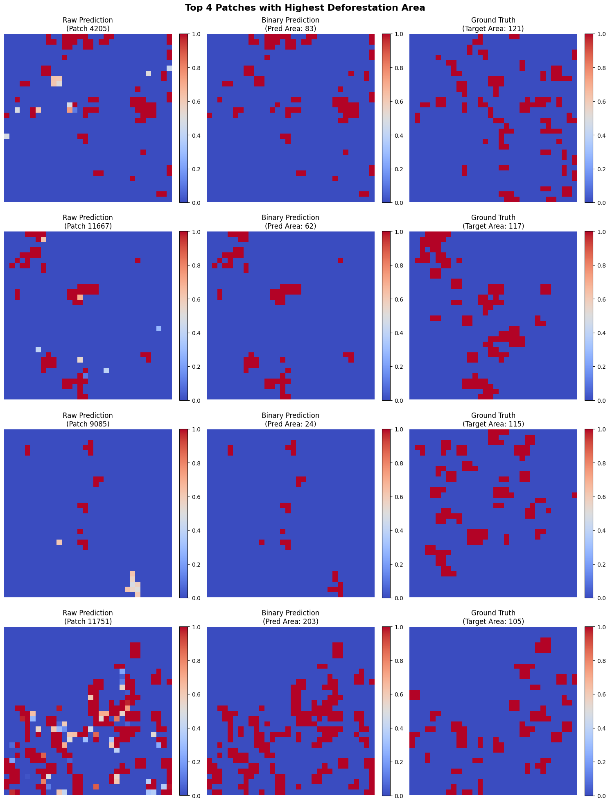
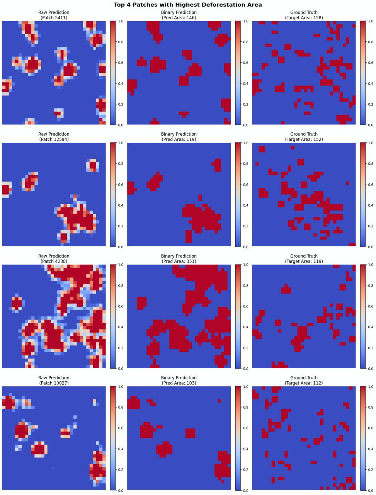

# Lightweight Neural Networks for Amazon Deforestation Prediction

Delivered PUC-Rio ELE2346 coursework project on forecasting deforestation masks from multitemporal Brazilian Amazon data. It uses DETER (Detection of Deforestation in Real Time) alerts published by INPE through [TerraBrasilis](https://terrabrasilis.dpi.inpe.br/en/download-files/).

<p align="center">
  
</p>

## Method

DETER alert polygons are rasterized to a 1 km grid and represented with five channels: deforested area, normalized polygon count, cumulative alerted area, alerted-area change, and a seasonal moving-average factor. Each example contains six historical frames with shape `(5, 6, 32, 32)` and predicts a binary deforestation mask for the next frame.

<p align="center">
  
</p>

The repository includes the two architectures evaluated in the report:

- `SimpleBaselineB`: one 3D convolution that collapses the temporal dimension.
- `Tiny3DUNet`: a lightweight residual 3D U-Net with spatial skip connections and temporal aggregation.

Additional model, loss, and plotting implementations are retained as experimental/reference code. `main.py` uses Tiny3DUNet by default.

## Results

| Model | IoU | Accuracy | Precision | Recall | F1 score |
| --- | ---: | ---: | ---: | ---: | ---: |
| Baseline | 0.065 | 0.975 | 0.080 | 0.230 | 0.119 |
| Tiny3DUNet | 0.046 | 0.943 | 0.050 | 0.384 | 0.088 |

The baseline achieved the stronger IoU and precision. Tiny3DUNet found more deforestation pixels (higher recall) at the cost of more false positives.

<p align="center">
  
  
</p>

## Repository layout

- `scripts/data_patch.py` prepares HDF5 patches from the source NPZ files.
- `main.py` trains and evaluates Tiny3DUNet.
- `src/` contains the dataset, models, loss, training loop, and utilities.
- `assets/images/` contains project figures reproduced from the final report.
- `notebooks/` contains exploratory analysis and visualisations.
- `config.yaml` defines data locations, training parameters, and output paths.

## Setup and use

Python 3.10+ is required. Install the PyTorch build appropriate for your platform, then install the project dependencies:

```sh
uv sync --group dev
make check
```

Run commands inside the managed environment with `uv run`, for example `uv run python main.py --config config.yaml`.

Raw data, generated HDF5 patches, checkpoints, predictions, plots, and results are excluded from version control. Configure the local NPZ paths in `config.yaml`, generate patches, then train:

```sh
uv run python scripts/data_patch.py
uv run python main.py --config config.yaml
```

The default configuration uses CUDA when available and otherwise falls back to CPU.

## Notes and limitations

To preserve the delivered experiment, the pipeline retains only sequences whose final target patch contains deforestation, uses a random patch-level train/validation split, thresholds raw logits at `0.5` for metrics, and collects evaluation predictions in memory before writing HDF5. Reassess these choices before applying the code to a new study.

## License

This project is available under the [MIT License](LICENSE).
